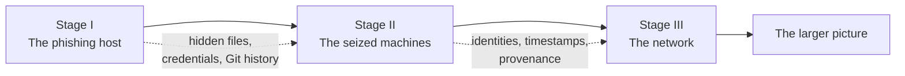

# Operation DeepFISH

> **A digital-forensics investigation told in three stages.**

[](https://github.com/sousa16/csf)
[](https://github.com/sousa16/csf)
[](WORKFLOW.md)

Something is wrong at the edge of a university network.

A convincing Fénix login page is harvesting credentials. An exposed Git
repository contains files hidden inside images, video, audio, and archives.
The same artifacts later turn up on seized workstations. And when the
investigation reaches the network, the case widens from a phishing campaign
into a compromised procurement system, stolen credentials, poisoned data, and
a conspiracy with people trying to frame one another.

This repository is the working record of that investigation: three graded
digital-forensics labs, their evidence, reports, timelines, helper scripts,
and the reproducible Kali environment used to examine them.

## The story



### Stage I — The phishing host

The first lead is a password-expiration lure pointing at a clone of the
university login page. A misconfigured server gives the investigation more
than it should: source code, a Git repository, credentials, and a trail of
media files that are not what they appear to be.

The evidence is deliberately layered. PNGs carry extra data, a video is a
polyglot, a ZIP is password-protected, audio hides information in a
spectrogram, and a large video conceals a message across frame pixels. The
challenge is not just to extract bytes, but to preserve provenance: where each
artifact came from, which command recovered it, and whether its SHA-256 still
matches.

### Stage II — The seized machines

The story leaves the server and lands on two workstations. Volatility analysis
recovers a BitLocker volume key from memory; the decrypted disk yields browser
history, PowerShell traces, images, event logs, and the operational residue of
the phishing campaign.

The handwritten note that looks like a password recipe becomes a chain of
cross-corroborated clues. The Linux workstation contains a copy of the
phishing project and a staging archive. Windows evidence shows remote
execution, timestamp manipulation, and cleared logs. Together, the machines
turn isolated artifacts into a timeline.

### Stage III — The network

The final stage follows the traffic. TLS key logs unlock captures from an
enterprise network, revealing internal services, chat, email, file transfers,
and the movement of the hidden files.

The investigation now reaches an AI-assisted procurement system. A staging
bypass suppresses compliance warnings; a deployed repository change poisons
retrieval data; credentials and a PGP key are stolen; and a voice note suggests
that evidence was planted to frame someone else. The original phishing
incident was only the visible edge of a much larger operation.

## What this repository contains

| Area | Contents |
| --- | --- |
| [`lab1/`](lab1/) | Phishing-site reconstruction, Git recovery, steganalysis, carving, and hidden-artifact extraction |
| [`lab2/`](lab2/) | Memory and disk forensics, BitLocker recovery, filesystem timelines, and cross-device correlation |
| [`lab3/`](lab3/) | PCAP investigation, TLS decryption, network identity mapping, object export, and incident reconstruction |
| [`scripts/`](scripts/) | Shared environment capture, artifact registration, and desktop helpers |
| [`Containerfile`](Containerfile) | Reproducible multi-architecture Kali forensic workstation |
| [`SETUP.md`](SETUP.md) | Container installation and command reference |
| [`WORKFLOW.md`](WORKFLOW.md) | Session discipline, evidence handling, and submission workflow |

Each lab keeps the same forensic spine:

```text
labN/
├── artifacts/             # supplied material; never modify
├── images/                # large source images; local and gitignored where applicable
├── evidence/              # recovered artifacts that belong in the submission
├── results/               # scratch output, logs, registers, and investigation notes
├── report-and-timeline/   # LaTeX report, timeline CSV, and generated deliverables
└── scripts/               # lab-specific, auditable helpers
```

> **Evidence rule:** if it goes in the submission ZIP, it belongs in
> `evidence/`. Work on copies, record the parent artifact and exact recovery
> command, then hash the final file in its final location.

## Reproduce the workstation

The repository includes an optional containerized Kali environment so the
toolchain does not depend on one investigator's laptop or VM.

```bash
git clone https://github.com/sousa16/csf.git
cd csf

./kali.sh build
./kali.sh shell
```

Useful entry points:

```bash
./kali.sh shell                         # interactive forensic shell
./kali.sh --net shell                   # shell with network enabled
./kali.sh desktop                       # XFCE through a browser
./kali.sh report lab1/report-and-timeline
./kali.sh run file lab1/artifacts/item
```

The default container has **no network access**. Use `--net` only when a
recovery genuinely requires it and record that decision in the report. The
image includes Sleuth Kit, Volatility 3, Autopsy, Wireshark/tshark, carving
and steganalysis tools, password-auditing utilities, FFmpeg, and the LaTeX
report toolchain. It runs natively on amd64 and arm64.

## Forensic principles

This project is built around a few rules that matter more than any individual
tool:

- supplied artifacts are read-only;
- recovered bytes are committed and hashed, rather than regenerated during
  packaging;
- commands are copied from recorded sessions, including failures;
- observation and interpretation are written separately;
- timestamps name their source and state any timezone conversion;
- every important conclusion is corroborated across artifacts where possible.

The result is meant to be auditable: another investigator should be able to
follow the register, rerun the command, inspect the output, and understand
exactly how a conclusion was reached.

## Course context

This is a group repository for the **Forensics Cyber-Security 2026/27** lab
assignments at Instituto Superior Técnico. The reports are the primary
deliverables; the repository is the chain of custody and reproducibility layer
around them.

Personal notes, lecture slides, and weekly tutorials live elsewhere and are
intentionally not included here. Do not commit raw disk images, recovered
passwords, real personal details, or other material outside the assignment's
evidence boundary.

## License

This repository is coursework and investigation material. No separate
software license is declared.
